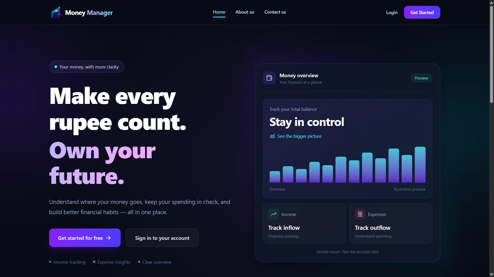
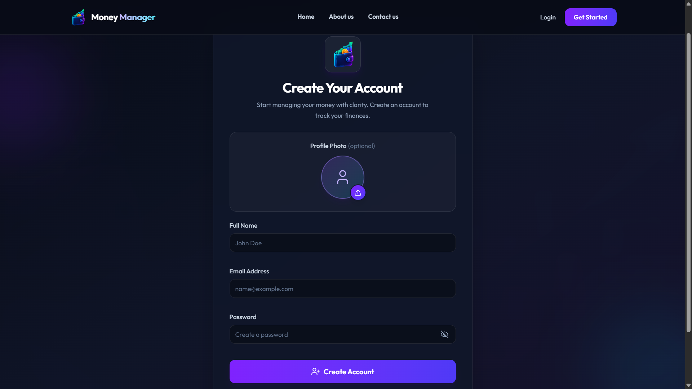
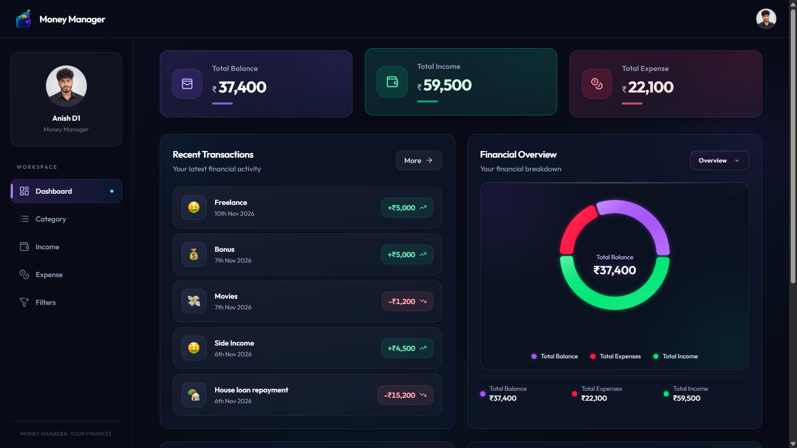

# Money Manager – Frontend

A full-stack personal finance management application built using **React and JavaScript**. Money Manager helps users manage their income and expenses through a dashboard with secure authentication and backend integration.

## 🌐 Live Demo

**[Open Money Manager](https://money-manager-frontend-one-wine.vercel.app/)**

## 📸 Application Screenshots

### 1. Landing Page



### 2. Registration Page



### 3. Dashboard



### 4. Income Management


### 5. Expense Management


## ✨ Features

- User registration and login
- JWT-based authentication
- Email-based account activation
- Personal finance dashboard
- Income management
- Expense management
- Profile image upload
- REST API integration using Axios
- Responsive user interface

## 🛠️ Tech Stack

| Technology | Purpose |
|---|---|
| React | Frontend library |
| JavaScript (ES6+) | Application logic |
| Axios | HTTP requests and API integration |
| HTML5 | Application structure |
| CSS3 | Styling and responsive design |
| Vite | Development and build tool |
| Vercel | Frontend deployment |

## 🔗 Backend Integration

The frontend communicates with a Java Spring Boot REST API.

**Backend Repository:** [Money Manager – Backend](https://github.com/Anish-D1/moneymanager)

**Backend URL:**

https://money-manager-backend-riu9.onrender.com

**API Base URL:**

```text
https://money-manager-backend-riu9.onrender.com/api/v1.0
```

## ⚙️ Getting Started

### Prerequisites

- Node.js
- npm
- Git

### 1. Clone the repository

```bash
git clone https://github.com/Anish-D1/moneymanagerwebapp.git
```

### 2. Navigate to the project directory

```bash
cd moneymanagerwebapp
```

### 3. Install dependencies

```bash
npm install
```

### 4. Configure environment variables

Create a `.env` file in the project root:

```env
VITE_API_URL=https://money-manager-backend-riu9.onrender.com
```

For local backend development, replace the URL with your local Spring Boot backend address.

### 5. Start the development server

```bash
npm run dev
```

### 6. Build for production

```bash
npm run build
```

## 🚀 Deployment

The frontend is deployed using **Vercel**.

- Source code maintained on GitHub
- Production build handled by Vite
- Backend API URL configured through environment variables

## 🔐 Authentication

The application integrates with the backend authentication system.

- JWT-based authentication
- Email-based account activation
- Authenticated communication with protected API endpoints

## 👨‍💻 Developer

**Anish Devan**

- GitHub: [Anish-D1](https://github.com/Anish-D1)
- LinkedIn: [Anish Devan](https://www.linkedin.com/in/anish-devan)

---

⭐ Built as a hands-on full-stack development project to strengthen my React and application development skills.
